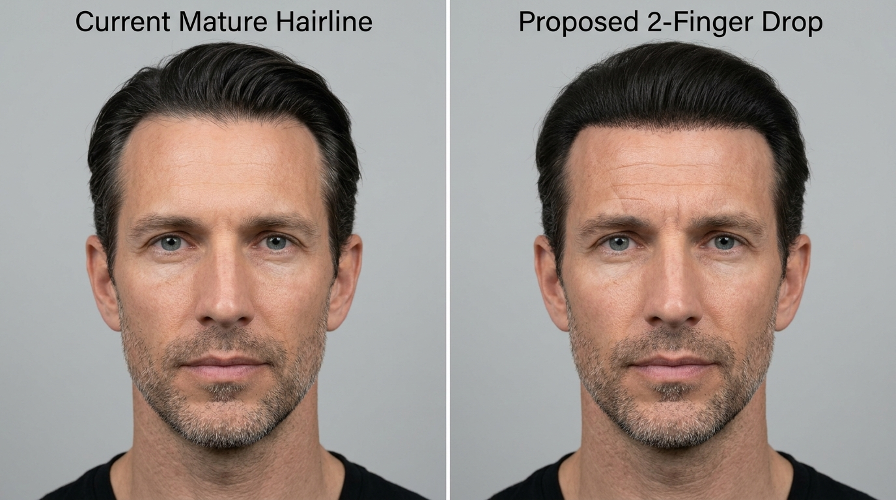
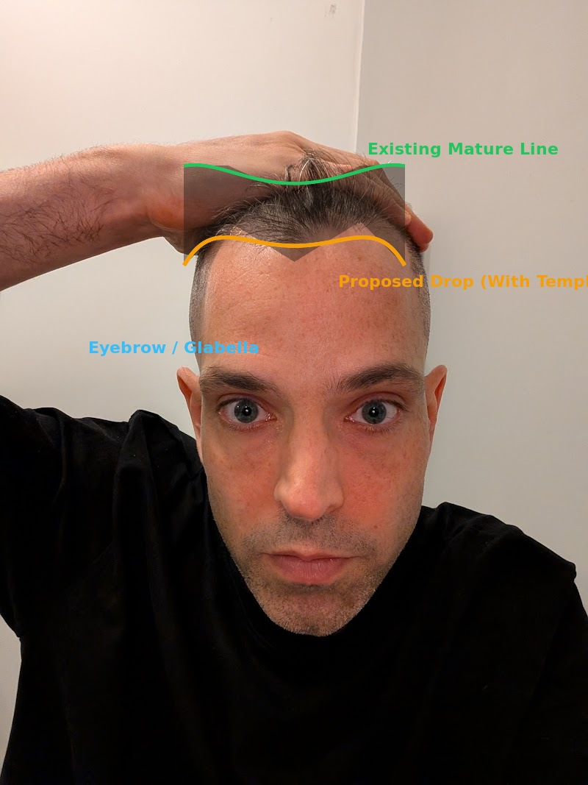
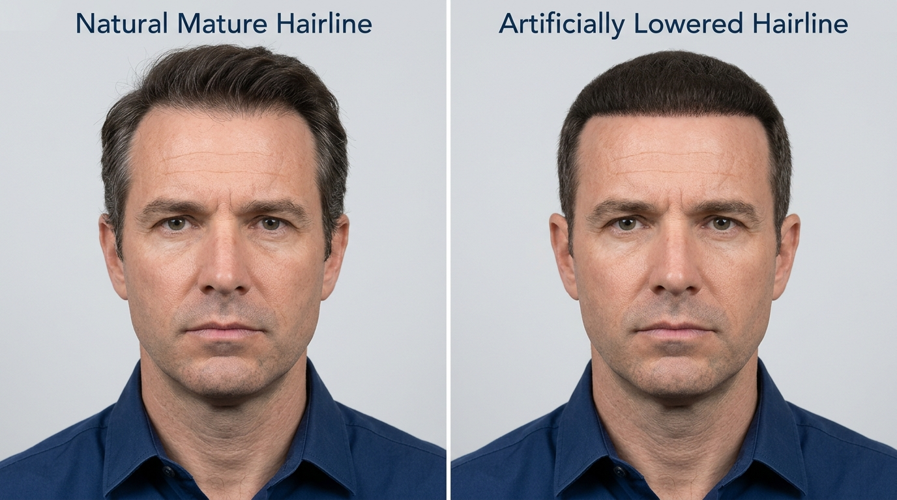
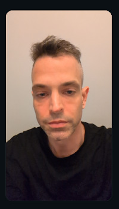
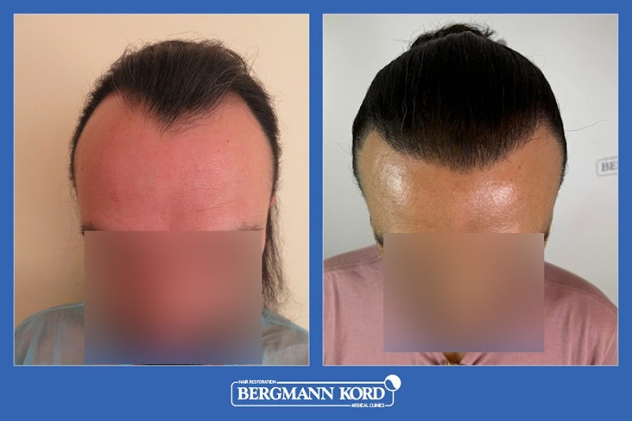

# תיק אסטרטגי: שיקום ועיבוי שיער | Hair Restoration & Care Vault

תיעוד מקיף, אובייקטיבי ומבוסס מדע לניהול צפיפות ובריאות השיער עבור אלעד בן-דוד (דבלין / אתונה / ישראל).

## תוכן עניינים וסעיפים עיקריים

1. **אבחון המצב האישי (Scalp & Follicle Profile):**
   - דפוס דלילות מפוזרת (Diffuse Thinning) בקודקוד ובמרכז הקרקפת עם שימור קו שיער קדמי.
   - שיער שיבה (מלח-פלפל): יתרון אסתטי מובהק בצמצום הניגודיות מול עור הקרקפת, לצד צורך במיומנות כירורגית גבוהה לחילוץ זקיקים שקופים.
   - זקיקים ממוזערים (חיים אך חלשים) מול אזורים צלקתיים.

2. **פרוטוקול תרופתי ומשלים (Non-Surgical Regimen):**
   - **פינסטריד (פרופסיה 1 מ"ג):** עוגן המניעה הקיים.
   - **דואוטסטריד (Dutasteride / Avodart 0.5mg):** חסימת 90% DHT לעומת 70% בפינסטריד, פוטנציאל עיבוי מחודש.
   - **מינוקסידיל קצף (Regaine 5% Foam):** ללא פרופילן גליקול, מתייבש תוך דקה ללא שומניות.
   - **מיקרונידלינג (Dermastamp):** 1.0 מ"מ עד 1.5 מ"מ פעם בשבוע (הפרדה של 24 שעות ממינוקסידיל).

3. **מדריך בירוקרטיה, רפואה ועלויות: דבלין (אירלנד) מול ישראל:**
   - **מינוקסידיל באירלנד:** נמכר ללא מרשם (OTC) בכל סניף Boots (כ-€65-80 למארז של 3 חודשים).
   - **מרשמים מקוונים בדבלין:** שימוש בשירותי Webdoctor.ie או LloydsPharmacy Online Doctor (€25-30 לייעוץ ומרשם דיגיטלי לבית מרקחת מקומי).
   - **ביטוח VHI:** אפס החזר על תרופות נשירה (מחורגות כטיפול קוסמטי), אך 50% החזר על עלות ביקור ה-GP בהתאם לפוליסה.
   - **אזהרה לגבי הוצאת מרשמים על שם האב בישראל:** דואוטסטריד מורידה את רמות ה-PSA בדם ב-50%, ולכן רישומה בתיק רפואי של אדם מבוגר עלולה לשבש מעקב אחר בריאות הערמונית.

4. **מערכות שיער (Hair Systems / פאות מודרניות) מול השתלה:**
   - מראה טבעי ומושלם כיום (בסיס פולימר דקיק או רשת תחרה).
   - חסרונות: תחזוקת דבקים שבועית תובענית, גילוח השיער הטבעי שמתחת, בלאי כל 2-4 חודשים, וחרדת מגע/רוח.

5. **מפת הדרכים לאתונה (Athens Hair Transplant Road-Map):**
   - **החלטה מבדלת:** ניצול הנסיעה הקרובה לפגישת ייעוץ ובדיקת קרקפת מיקרוסקופית (טריכוסקופיה) בלבד.
   - מניעת שילוב שני ניתוחים (שאיבת שומן + השתלת שיער) באותו שבוע עקב התנגשות בהנחיות שינה, בצקות והחלמה.
   - מרפאות מובילות באתונה: Advanced Hair Clinics (ד"ר ווקריס), DHI Global Medical Group, Seneca Medical Group.
   - שאלות חובה לסינון מרפאות וטיוטת פנייה באנגלית.

#### 5. הדמיה קלינית ממוקדת: הנמכת 2 אצבעות תוך שמירה על מפרצים (With Temples)
מענה ישיר לדגש של המוכרת (שלא מדובר בפס ישר אלא בקו מדורג השומר על מפרצים):
גם כאשר קו השיער אינו ישר ומתוכנן עם מפרצים ומפרצונים, הנמכה של שתי אצבעות כלפי מטה (מימין) סוגרת ומקצרת את המצח, מתנגשת בקמטי המצח הטבעיים, ומייצרת חזית כבדה לעומת המראה ההרמוני המקורי (משמאל):

#### 6. שרטוט קו המפרצים המוצע (צהוב) ישירות על תמונת המצח שלך
המחשה ישירה על גבי התצלום שלך: הקו הירוק מציין את קו השיער הבוגר הקיים. הקו הצהוב והשטח המוצלל מייצגים בדיוק את הצעת המרפאה (הנמכה של 2 אצבעות עם מפרצים עולים בצדדים):

---

---

## 6. ביקורת שיחת אתונה (ברגמן קורד), הדמיה קלינית והערכת כדאיות (נובמבר 2026)

### 📌 שורה תחתונה ופסק דין קליני
ההשתלה המוצעת על ידי נציגת המרפאה באתונה (Bergmann Kord) מיותרת לחלוטין ועלולה לפגוע במראה האסתטי שלך. כשהשיער שלך מסופר ומעוצב (דירוג פייד עדין וטקסטורה למעלה), יש לך רעמת שיער מלאה, צפופה ומרשימה. המפרצים הקלים שלך טבעיים לגיל 42. הנמכת קו המצח ב"שתי אצבעות" תיצור מראה דחוס, לא פרופורציונלי ומלאכותי, תבזבז בנק זקיקים יקר, ותחשוף אותך לסיכונים כירורגיים מיותרים.

### 🖼️ גלריית הדמיות וניתוח פרופורציות

#### 1. הדמיה קלינית השוואתית: קו שיער טבעי בוגר מול קו מונמך מלאכותי
הדמיה קלינית הממחישה את ההבדל בין קו שיער בוגר והרמוני (משמאל) לבין קו שיער שהונמך מלאכותית בשתי אצבעות (מימין), המייצר מצח מכווץ ומראה דמוי פאה/קסדה:

#### 2. ניתוח גיאומטרי של קווי הפנים וחוק השלישים על התצלום האישי
ניתוח חוק השלישים של הפנים (Rule of Thirds) המדגים מדוע הקו הקיים (ירוק) יושב באיזון מושלם, בעוד הקו שהוצע על ידי המרפאה (אדום) פולש לאזור שריר המצח ומפר את הפרופורציות:

#### 3. המראה הטבעי והמעוצב שלך בפועל
תצלום מתוך שיחת הווידאו עצמה: כשהשיער אינו משוך בכוח לאחור אלא מעוצב טבעי, הראש נראה מלא, שופע ומודרני:

#### 4. דוגמה מטיפולי המרפאה (קו מונמך שנראה מלאכותי)
דוגמה שהוצגה על ידי נציגת המרפאה (מטופל שקיבל קו מונמך ומעוגל, היוצר אפקט לא טבעי):

---

### 🔍 ניתוח חוק השלישים של הפנים (Rule of Thirds)
פרופורציות פנים הרמוניות נמדדות לפי חלוקה לשלושה שלישים:
1. **שליש תחתון:** מבסיס הסנטר (Menton) לבסיס האף (Subnasale).
2. **שליש אמצעי:** מבסיס האף לקו הגבות (Glabella).
3. **שליש עליון:** מקו הגבות לקו השיער (Trichion).

* **המצב הקיים אצלך (הקו הירוק):** קו השיער הנוכחי יושב בהרמוניה מלאה עם מבנה הפנים המוארך, עצמות הלחיים וקו הלסת. מדובר בקו שיער בוגר (Mature Hairline) אותנטי וגברי.
* **הצעת המרפאה (הקו האדום, "שתי אצבעות למטה"):** כיווץ השליש העליון ייצר מצח קצר בצורה לא טבעית ויפר את האיזון הכללי של הפנים.

---

### ⚠️ ארבע המלכודות האנטומיות של "הורדת שתי אצבעות"
1. **פלישה לשריר המצח (Frontalis Muscle):** שתי אצבעות מתחת לקו הנוכחי מגיעות לאזור המתכווץ בהבעות פנים. השתלת שיער על שריר פעיל גורמת לשיער המושתל לנוע באופן מעוות בכל הרמת גבות.
2. **אפקט "פגוש השיער" (Bumper Effect):** המרפאה הצהירה שלא תיגע בחלק העליון הדליל יותר. התוצאה: פס שיער מושתל, ישר וכהה מקדימה, עם מעבר חד לשטח טבעי ודק יותר מאחוריו.
3. **בזבוז בנק הזקיקים לכל החיים:** שריפת 1,800 זקיקים על הנמכת מצח מיותרת תמנע כיסוי של אמצע הראש או הקודקוד בעתיד.
4. **המציאות מול השיער המשוך לאחור:** המפרצים בולטים רק כשמותחים את השיער לאחור במכוון. בשגרה, עם תספורת מדורגת, אין שום סימן להתקרחות.

---

### 📊 מטריצת עלות-תועלת (ROI)

| פרמטר | השתלת קו שיער באתונה | מצב קיים + טיפול שמרני |
| :--- | :--- | :--- |
| **עלות כספית ישירה** | כ-3,500 אירו (ניתוח, טיסות, מלון) | 0 אירו הוצאות כירורגיות |
| **תוצאה אסתטית** | שלילית (סיכון לקו מלאכותי ומצח מעוות) | מקסימלית (מראה גברי, טבעי ומלא) |
| **זמן השבתה והחלמה** | גילוח ראש מלא, אדמומיות, גלדים והלם נשירה | 0 ימי השבתה |
| **סיכון רפואי** | הרדמה מקומית ואפינפרין עם מסתם דו-צנפי | אפס סיכון |
| **רזרבת זקיקים לעתיד**| אובדן של 1,800 זקיקים מהבנק התורם | 100% רזרבה שמורה לכל צורך עתידי |

---

### 🎯 המלצה מעשית
1. **לוותר על ההצעה של Bergmann Kord:** אין להעביר מקדמה ואין לבצע הנמכת קו מצח.
2. **להמשיך בשגרה התרופתית:** להמשיך נטילת פרופסיה (פינסטריד 1 מ"ג) כסדרה, ולא להפסיק לפי עצת המוכרת.
3. **התמקדות בנסיעה בינואר:** להקדיש את הנסיעה לאתונה לפרוצדורה העיקרית ללא פיצול קשב או עומס כירורגי כפול.

*קובץ זה מלווה בפורטל וובי אינטראקטיבי מלא: `index.html`*

* **דף תזכורת וצ'ק-ליסט לפגישת הקרדיולוג בדבלין (נובמבר 2026):** `cardiologist_checklist.html` (זמין גם ב-go/cardiologist-checklist)

---

## 8. פרוטוקול טיפוח עור מדעי לגברים • שתי דקות ביום (`skincare_protocol.html`)

מדריך מבוסס ראיות רפואיות להסרת מיתוסי קוסמטיקה, מיקוד במה שבאמת עובד, והשגת 90% מתוצאות האנטי-אייג'ינג במינימום חיכוך ועלות:

* **האמת המדעית על סרומים:** 95% מהסרומים בשוק (חומצה היאלורונית, פפטידים, ריר חלזונות) הם מים יקרים שאינם משנים את מבנה העור.
* **דרג 1 (מלכי האנטי-אייג'ינג - 90% מהתוצאות):** רטינואיד/רטינול בלילה (מחדש קולגן ומאיץ תחלופת תאים) + מקדם הגנה SPF 50 בבוקר (מניעת 90% מנזקי השמש וההזדקנות).
* **דרג 2 (תוספת בונוס אופציונלית בלבד):** סרום ויטמין C טהור (L-Ascorbic Acid 15%) בבוקר (נוגד חמצון המעניק זוהר שטחי). אם השימוש מעיק או גורם לטרחה, מוותרים עליו ללא היסוס.
* **פרוטוקול שתי הדקות:** בוקר (שטיפת מים + ויטמין C + SPF 50) | לילה (ניקוי עדין + רטינול בגודל אפונה + קרם לחות בסיסי).
* **מוצרים נבחרים:** Geek & Gorgeous C-Glow (€12.50 באתר הרשמי) | La Roche-Posay Pure C10 (€38-42 ב-Boots) | The Ordinary Retinoid (€9-12).
